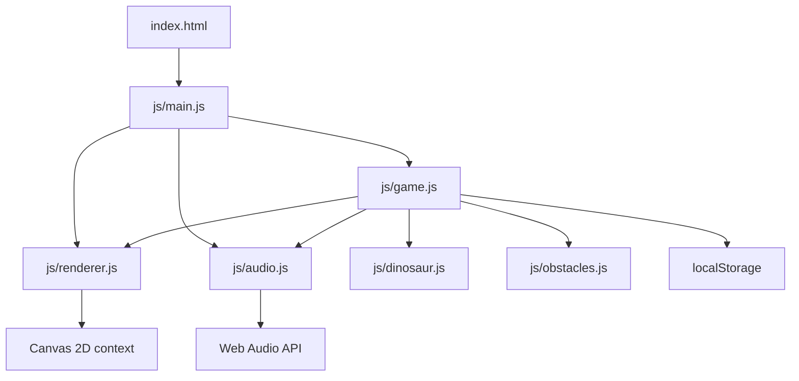

# Kiến trúc VanhCodes Dino Remake

## Tổng quan

VanhCodes Dino Remake là web game 2D chạy trong trình duyệt, lấy cảm hứng từ Chrome Dino với phong cách pixel được vẽ trực tiếp bằng Canvas 2D. V1.0 tập trung vào trải nghiệm chơi cốt lõi và một Final Scene hài hước, bất ngờ. Tài liệu này mô tả nền tảng đã thống nhất; các hệ thống gameplay sẽ được triển khai ở giai đoạn sau.

## Công nghệ và giới hạn

- HTML5 cung cấp tài liệu và canvas; CSS3 bố cục trang.
- JavaScript ES Modules phân chia mã nguồn theo trách nhiệm.
- Canvas 2D là bề mặt render duy nhất cho đồ họa gameplay.
- Web Audio API sẽ tổng hợp hiệu ứng âm thanh trong trình duyệt.
- `localStorage` dành cho điểm kỷ lục và tùy chọn cục bộ.
- Không dùng framework, engine ngoài, sprite sheet, ảnh nhân vật hoặc tệp âm thanh dựng sẵn.
- Không có backend trong giai đoạn này. Sản phẩm định hướng online-first và có thể triển khai như static site.

## Cấu trúc thư mục

```text
.
├── index.html
├── README.md
├── ARCHITECTURE.md
├── css/
│   └── style.css
└── js/
    ├── main.js
    ├── game.js
    ├── dinosaur.js
    ├── obstacles.js
    ├── renderer.js
    └── audio.js
```

## Trách nhiệm module

| Module | Trách nhiệm |
| --- | --- |
| `main.js` | Entry point; lấy Canvas 2D và nối các hệ thống khi được triển khai. Chỉ giữ bootstrap trình duyệt, không chứa quy tắc gameplay. |
| `game.js` | Sở hữu vòng đời game, game loop, trạng thái tổng thể, điểm/tốc độ và điều phối gameplay, bao gồm điều kiện vào Final Scene. |
| `dinosaur.js` | Trạng thái và hành vi Dino chính: chạy, nhảy, cúi, va chạm; xử lý chuyển động/vật lý khi gameplay được xây dựng. |
| `obstacles.js` | Định nghĩa và quản lý xương rồng, Pterodactyl, sinh/chuyển động chướng ngại và kiểm tra va chạm. |
| `renderer.js` | Vẽ môi trường, nhân vật, chướng ngại, giao diện Canvas và Final Scene; chịu trách nhiệm quy tắc pixel art và hoạt ảnh hiển thị. |
| `audio.js` | Tạo/quản lý AudioContext, âm thanh tổng hợp, âm lượng và trạng thái âm thanh cho gameplay/Final Scene. |

Hai Dino phụ chỉ tồn tại trong Final Scene. Renderer vẽ trạng thái/hoạt ảnh của chúng theo dữ liệu cảnh; `game.js` điều phối thời điểm chuyển cảnh; không đưa chúng vào vòng đời Dino chính.

## Quan hệ phụ thuộc



Mũi tên biểu thị module gọi hoặc sử dụng năng lực của module ở giai đoạn triển khai. Đồ thị phải giữ một chiều: `main.js` là composition root; `renderer.js` và `audio.js` không import ngược `game.js`; module nhân vật/chướng ngại không phụ thuộc renderer hoặc entry point. Tránh circular dependencies bằng cách truyền dữ liệu và callback/đối tượng năng lực qua ranh giới module thay vì import chéo.

## Luồng khởi tạo

1. Trình duyệt tải `index.html`, stylesheet và `js/main.js` dưới dạng ES module.
2. `main.js` truy vấn `#game-canvas` và lấy Canvas 2D context; báo lỗi khởi tạo rõ ràng nếu thiếu canvas hoặc context.
3. Khi các hệ thống được triển khai, entry point tạo renderer/audio/game và truyền các phụ thuộc cần thiết vào game.
4. Game thiết lập trạng thái ban đầu, đọc dữ liệu cục bộ cần thiết, rồi bắt đầu vòng lặp.

Ở cấu trúc hiện tại chỉ có các bước tải trang và kiểm tra Canvas; game chưa khởi tạo hay chạy.

## Vòng đời dự kiến và giao tiếp module

Game loop thuộc `game.js`. Mỗi frame, game tính delta time, cập nhật trạng thái simulation, rồi yêu cầu renderer vẽ snapshot trạng thái hiện tại. Trình tự dự kiến:

1. Đọc input và cập nhật trạng thái game.
2. Cập nhật Dino chính và chướng ngại theo delta time.
3. Xử lý va chạm, điểm, tốc độ và điều kiện kết thúc/chuyển cảnh.
4. Gửi sự kiện âm thanh tương ứng tới `audio.js`.
5. Gửi snapshot trạng thái tới `renderer.js` để vẽ một frame.

Module mô hình hóa trạng thái và hành vi; renderer không sửa simulation. Audio không quyết định luật chơi. Các module giao tiếp qua hàm/đối tượng export có mục đích rõ ràng và dữ liệu trạng thái đơn giản. Chỉ game điều phối thay đổi trạng thái toàn cục.

## Trạng thái gameplay

`game.js` sở hữu trạng thái cấp game, dự kiến gồm `ready`, `running`, `gameOver` và `finalScene` (cùng trạng thái tạm dừng nếu cần). Chuyển trạng thái đi qua các hàm điều phối tập trung, tránh sửa cờ trạng thái rải rác. Dino chính có trạng thái riêng như chạy, nhảy, cúi và va chạm; hai Dino phụ có trạng thái riêng chỉ trong Final Scene. Dữ liệu điểm cao và tùy chọn âm thanh được lưu cục bộ; việc truy cập storage cần có fallback nếu trình duyệt chặn hoặc không cung cấp storage.

## Canvas và pixel art

- Chỉ `renderer.js` vẽ gameplay lên Canvas; không dùng DOM element làm sprite.
- Dùng hệ tọa độ logic ổn định và scale lên kích thước hiển thị theo tỉ lệ; xử lý resize tập trung tại renderer.
- Tắt smoothing khi scale pixel để giữ cạnh sắc; ưu tiên hình học pixel có tọa độ/kích thước nguyên trong hệ tọa độ logic.
- Renderer nhận trạng thái để vẽ, không sở hữu vật lý, va chạm hay sinh chướng ngại.
- Giữ màu, kích thước logic và thông số render trong cấu hình tập trung, tránh hard-code lặp ở nhiều module.

## Web Audio API

`audio.js` sở hữu vòng đời `AudioContext`, tạo âm bằng oscillator/node và envelope thay vì tải tệp âm thanh. Khởi tạo hoặc resume context sau thao tác người dùng đầu tiên để tuân thủ chính sách autoplay của trình duyệt. Cung cấp các lệnh mức cao cho sự kiện game, đồng thời quản lý mute/volume tập trung. Game quyết định khi nào phát sự kiện; module audio quyết định cách tổng hợp.

## Quy ước mã nguồn

- Dùng ES module tường minh với `import`/`export`; đường dẫn import tương đối có đuôi `.js` để hoạt động trên static hosting.
- Tên file chữ thường, dạng kebab-case nếu cần nhiều từ; tên lớp PascalCase, hàm/biến camelCase, hằng số cấu hình UPPER_SNAKE_CASE.
- Mỗi module giữ một trách nhiệm. Không thêm module riêng nếu chưa có ranh giới trách nhiệm thực sự.
- Tránh trạng thái global; truyền phụ thuộc rõ ràng từ entry point và dữ liệu giữa các hệ thống qua API nhỏ.
- Dùng đường dẫn tương đối để hỗ trợ deploy ở thư mục con trên GitHub Pages.

## Khả năng mở rộng

- Skin có thể bổ sung qua cấu hình/palette và các hàm vẽ trong renderer, không thay đổi luật game.
- Chế độ chơi mới có thể được điều phối trong game; chỉ tách module khi có vòng đời/luật riêng đủ lớn.
- Thành tích và hồ sơ cục bộ có thể bắt đầu với storage adapter mỏng; leaderboard/tài khoản trực tuyến cần backend hoặc dịch vụ ngoài và nằm ngoài V1.0.
- Quảng cáo nên gắn qua lớp bố cục trang, tách khỏi Canvas và simulation.
- PWA/offline có thể bổ sung manifest/service worker sau này; tài nguyên hiện tại được thiết kế để phục vụ static hosting.

## Giới hạn và lưu ý kỹ thuật

- Canvas raster hóa nội dung; cần kiểm thử kích thước màn hình, mật độ pixel và khả năng truy cập thay thế cho nội dung canvas.
- `localStorage` đồng bộ, giới hạn dung lượng và có thể không khả dụng; lưu trữ chỉ phù hợp dữ liệu nhỏ, không nhạy cảm.
- Web Audio có thể bị chặn trước tương tác người dùng và cần xử lý trạng thái context.
- Game loop cần dùng delta time và giới hạn ảnh hưởng của thời gian tab nền để tránh bước cập nhật bất thường.
- Static hosting không cung cấp lưu trữ leaderboard/tài khoản an toàn; các tính năng đó cần thiết kế backend riêng.

## Trạng thái hiện tại

Đã tạo khung HTML/CSS, Canvas bootstrap và sáu module theo ranh giới trách nhiệm. Chưa có game loop, gameplay, điều khiển, vật lý, sinh chướng ngại, render pixel hoàn chỉnh, animation, âm thanh, lưu điểm hoặc Final Scene.
